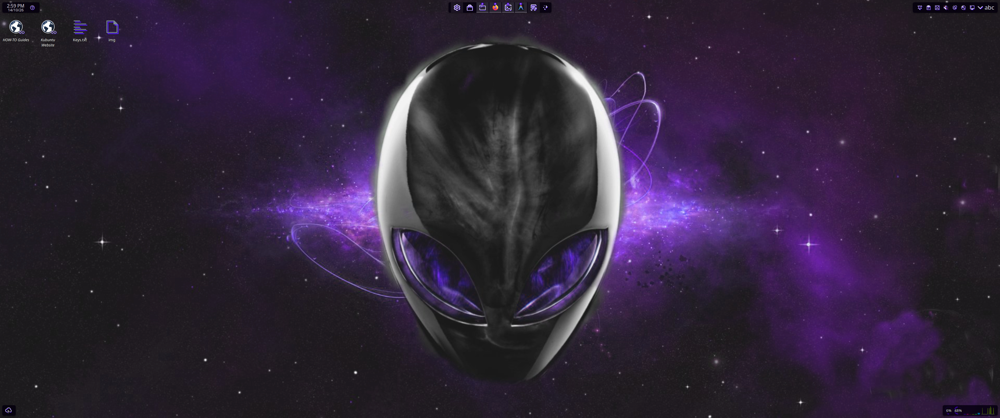
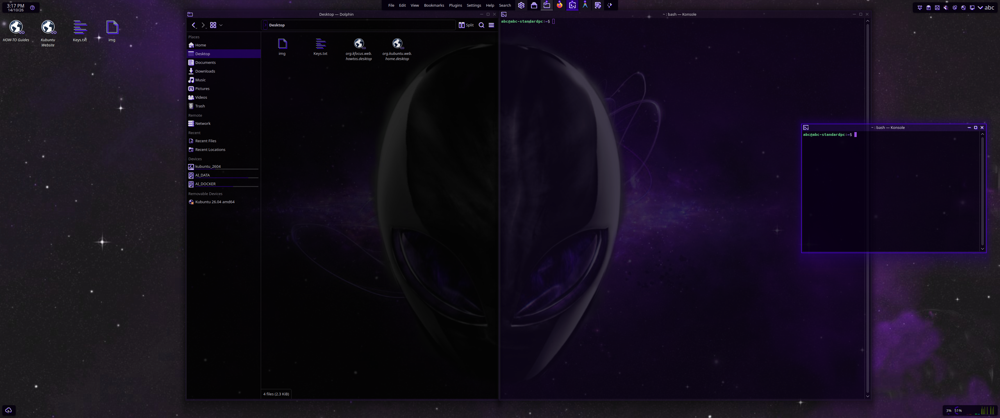
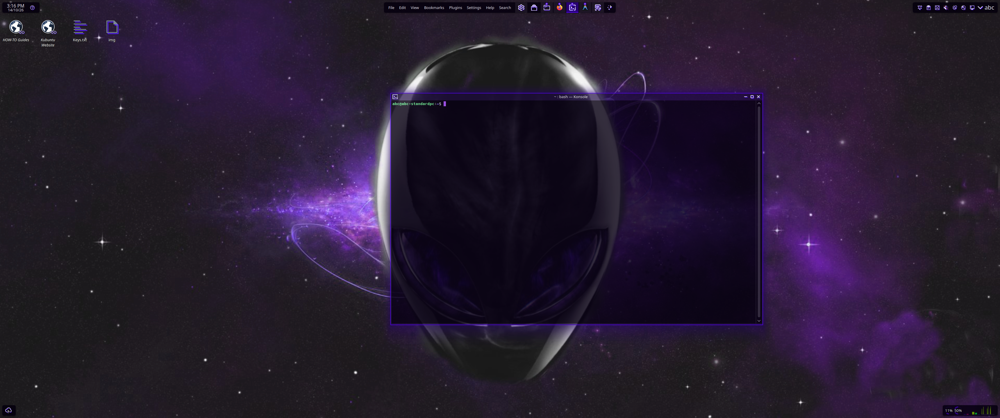
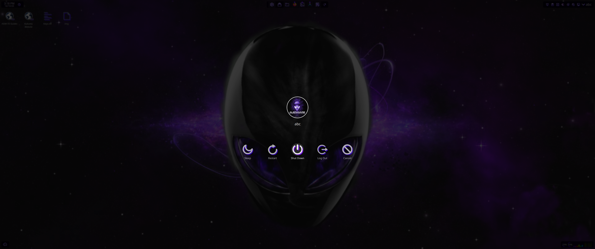

# VioletHUD 🔮

> A comprehensive, cyber-violet HUD theme suite and floating desktop experience designed for **KDE Plasma 6** on Kubuntu and modern Linux distributions.

[](https://kde.org/plasma-desktop/)
[](https://kubuntu.org/)
[](LICENSE)
[](#)

---

## 🌟 Overview

**VioletHUD** transforms your KDE Plasma 6 desktop into an integrated, cybernetic violet workstation. It coordinates everything from the UEFI boot splash and login manager to glowing vector window decorations, translucent windows, customized system monitors, and a modular 5-piece floating HUD panel system.

<p align="center">
  
</p>

---

## 📸 Screenshots

| Desktop & Floating HUD Panels | Dolphin & Translucent Windows |
| :---: | :---: |
| [](screenshots/desktop.png) | [](screenshots/screenshot1.png) |
| *5-piece floating HUD layout with Alienware purple wallpaper* | *Dolphin file manager with SoursCompiled icons & window translucency* |

| Konsole Cyberpunk Terminal | SDDM / Plasma Logout Screen |
| :---: | :---: |
| [](screenshots/konsole.png) | [](screenshots/logout.png) |
| *Semi-transparent Konsole profile with purple glow borders* | *Session logout dialog featuring Alienware badge & glowing controls* |

---

## 🧩 Components Suite

| Component | Asset / Package | Target Path | Description |
| :--- | :--- | :--- | :--- |
| **Window Decoration** | `assets/aurorae/VioletHUD` | `/usr/share/aurorae/themes/` | Neon violet vector borders and buttons |
| **Color Scheme** | `PurpleHUD.colors` | `/usr/share/color-schemes/` | High-contrast neon violet and obsidian palette |
| **Cursor Theme** | `invader-64-purple` (Alienware Purple) | `/usr/share/icons/` | Full animated Alienware purple cursor suite at 48px/64px |
| **Icon Theme** | `SoursCompiled` | `/usr/share/icons/` | Custom glowing icon theme |
| **Widget Style** | `VioletHUD` (Kvantum) | `/usr/share/Kvantum/` | Translucent SVG widget styling |
| **Konsole** | `VioletHUD.profile` + `VioletHUD.colorscheme` | `/usr/share/konsole/` | Cyberpunk terminal profile (selected as default) |
| **Profile Avatar** | `assets/avatar/user-avatar.png` | `~/.face` & AccountsService | High-res Alienware violet badge profile picture |
| **Splash Screen** | `VioletHUD` Look-and-Feel | `/usr/share/plasma/look-and-feel/` | Clean animated startup splash |
| **Desktop Panels** | 5 Floating HUD Panels | `~/.config/` | Top: Clock, Apps/Shortcuts Dock, Tray; Bottom: Weather, System Metrics |
| **Window Rules** | `Translucent-Windows.rules` | `~/.config/kwinrulesrc` | Window translucency & KWin script |
| **Login Screen** | `kde_settings.conf` + `theme.conf.user` | `/etc/sddm.conf.d/` & SDDM themes | SDDM Breeze with VioletHUD wallpaper & Invader cursor |
| **Boot Splash** | `VioletHUD` Plymouth | `/usr/share/plymouth/themes/` | High-resolution boot splash with glowing progress dots |
| **Wallpaper** | `VioletHUD` (Alienware Purple) | `/usr/share/wallpapers/` | High-definition 1080p HUD wallpaper |

---

## 🚀 Quick Start

### 1. Clone the Repository
```bash
git clone https://github.com/CyberRoamer/kubuntu26theme-violetHUD.git
cd violetHUD-repo
```

### 2. Run the Automated Installer
The installer automates asset deployment, permissions, cache rebuilding, and Plasma activation:

```bash
# Full installation (Themes + Wallpaper + 5 Floating HUD Panels)
sudo ./install.sh

# Theme only (Install styles & assets, preserve existing panels)
sudo ./install.sh --no-panels

# Panels only (Apply only wallpaper and floating HUD panels)
sudo ./install.sh --panels-only
```

> **Note on Backups:**  
> The installer automatically creates a safety snapshot of existing configurations under `/var/backups/violethud/` before making any changes.

---

## 🖥️ Desktop Panels Layout

The `--all` installation configures a modular 5-piece floating HUD layout with three panels across the top and two panels across the bottom:

```text
+---------------------------------------------------------------------------------------------------+
| [Clock | Battery]            [Kickoff | Open Apps & Shortcuts Dock]          [System Tray | User] |
| (Floating Panel 56)                   (Floating Panel 53)                     (Floating Panel 81) |
|                                                                                                   |
|                                                                                                   |
|                                                                                                   |
| [Weather]                                                               [RAM | CPU | CORES | NET] |
| (Floating Panel 100)                                                     (Floating Panel 102)     |
+---------------------------------------------------------------------------------------------------+
```

### Top Panels (3 Panels)
* **Top-Left (Panel 56):** Digital Clock with date display and battery level indicator.
* **Top-Center (Panel 53):** Floating application dock displaying open applications (Icons-Only Task Manager), pinned shortcuts, and the Kickoff application launcher.
* **Top-Right (Panel 81):** System status tray, notification center, and active user profile indicator (`abc`).

### Bottom Panels (2 Panels)
* **Bottom-Left (Panel 100):** Real-time weather HUD widget (defaults to Delhi, customizable via right-click settings).
* **Bottom-Right (Panel 102):** System metrics HUD calibrated in neon violet (`#300090`) displaying live RAM usage, total CPU load, individual core metrics, and real-time network traffic graphs.

---

## 🔄 Uninstallation

To cleanly remove all installed theme assets and restore your original configurations from backup:

```bash
sudo ./uninstall.sh
```

---

## 🛠️ Repository Structure

```
violetHUD-repo/
├── assets/                 # All theme asset trees
│   ├── aurorae/            # Window decoration SVGs
│   ├── color-schemes/      # KDE color scheme files
│   ├── cursors/            # Purple cursor themes
│   ├── icons/              # SoursCompiled icon theme
│   ├── konsole/            # Konsole profiles & colors
│   ├── kvantum/            # Kvantum SVG theme
│   ├── kwin/               # KWin rules and opacity script
│   ├── plasma/             # Look-and-Feel splash & panels
│   ├── plymouth/           # Boot splash theme
│   ├── sddm/               # SDDM login configuration
│   └── wallpapers/         # 1080p Wallpaper package
├── docs/                   # Documentation & manuals
│   ├── COMPONENTS.md       # Technical component specs
│   ├── MANUAL_INSTALL.md   # Step-by-step manual setup
│   └── TROUBLESHOOTING.md  # Common issues and solutions
├── screenshots/            # Theme screenshots & desktop previews
│   ├── desktop.png         # Desktop overview with 5 floating HUD panels
│   ├── konsole.png         # Konsole cyberpunk terminal
│   ├── logout.png          # SDDM / Plasma logout screen
│   └── screenshot1.png     # Dolphin & Konsole translucency showcase
├── tools/                  # Developer utilities
│   ├── build-tarball.sh    # Release packaging script
│   └── inventory.sh        # System configuration auditor
├── install.sh              # Unified installer
├── uninstall.sh            # Unified uninstaller
└── README.md
```

---

## 📖 Further Documentation

* [Component Specifications](docs/COMPONENTS.md)
* [Manual Installation Guide](docs/MANUAL_INSTALL.md)
* [Troubleshooting Guide](docs/TROUBLESHOOTING.md)

---

## 📄 License

This project is licensed under the [GNU General Public License v3.0](LICENSE).
